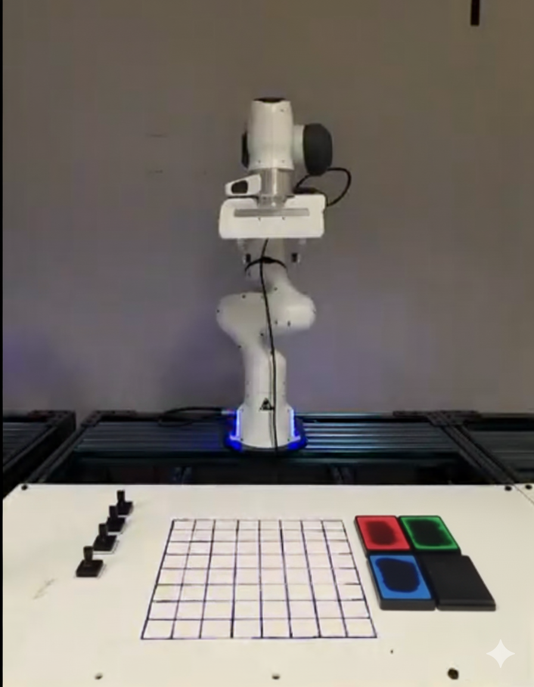

# Pixel Art Robot - Team CopyPasta


A robotic system that creates pixel art using a Franka Panda robot arm with colored stamps. The robot autonomously picks up colored stamps, dabs them on ink pads, and stamps pixels on a canvas to recreate digital images in the physical world.

## Project Overview

This project implements an end-to-end pipeline for robotic pixel art creation:
- **Computer Vision**: Processes input images and converts them to robot-executable pixel coordinates
- **Task Planning**: Optimizes stamp usage and movement paths using Traveling Salesman Problem (TSP) algorithms
- **Robot Control**: Precise manipulation of a Franka Panda arm for stamp handling and pixel placement
- **ROS Integration**: Real-time pose estimation and coordination between vision and control systems

```
Input Image → Image Processing → Pixel Extraction → Task Planning → Robot Execution
```

- **Vision Pipeline**: ArUco marker detection for stamp pad localization
- **Path Optimization**: Christofides algorithm for efficient movement
- **Safety Systems**: Workspace bounds and collision avoidance


## Hardware Requirements

- **Robot**: Franka Panda 7-DOF arm
- **Camera**: RGB camera for ArUco detection
- **Stamps**: 4 colored stamps (Red, Green, Blue, Black)
- **Ink Pads**: Corresponding colored ink pads
- **Canvas**: White paper or canvas surface
- **Markers**: ArUco markers for pose estimation

## Videos

## Report